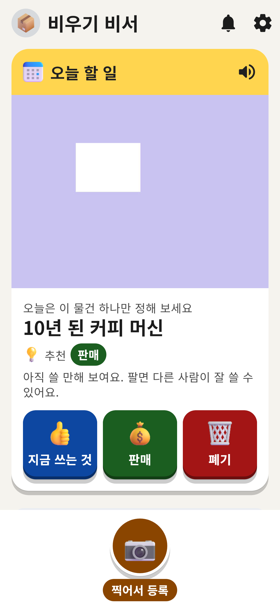
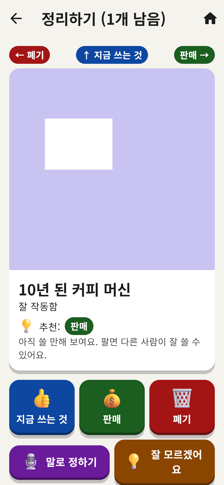
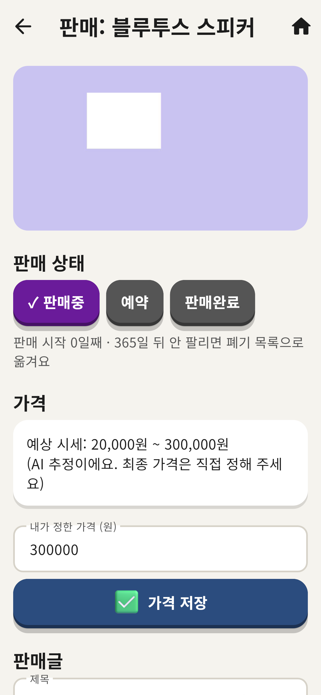
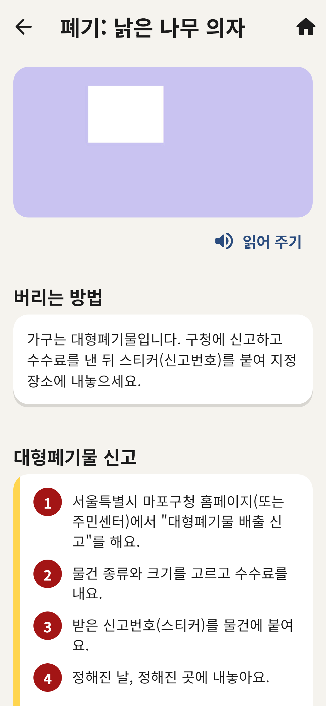
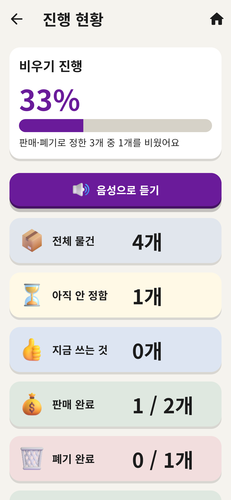

# 집안 물건 비우기 판매 폐기 비서

집안 물건을 사진·영상으로 등록하면 **지금 쓰는 것(파랑) / 판매(초록) / 폐기(빨강)** 세 가지로 나누고,
판매글 작성과 버리는 방법 안내까지 도와 집을 가볍게 비우게 해 주는 앱입니다.

| 홈 | 정리하기 | 판매 도우미 | 폐기 도우미 | 진행 현황 |
|---|---|---|---|---|
|  |  |  |  |  |

---

## 1. 앱 내려받기 (설치)

앱 파일은 GitHub가 자동으로 만들어 둡니다.

1. 이 저장소 페이지 위쪽의 **Actions** 탭을 누릅니다.
2. 맨 위 초록 체크(✓)가 있는 **"빌드와 테스트"** 항목을 누릅니다.
3. 맨 아래 **Artifacts** 에서 내 기기에 맞는 파일을 받습니다.

| 기기 | 받을 파일 | 설치 방법 |
|---|---|---|
| 안드로이드 휴대폰 | `안드로이드-APK` | 압축을 풀고 `app-release.apk`를 휴대폰으로 옮겨 누르면 설치돼요. "출처를 알 수 없는 앱 허용"을 물으면 허용하세요. |
| 윈도우 컴퓨터 | `윈도우-앱` | 압축을 풀고 폴더 안의 `binugi.exe`를 두 번 누르세요. 폴더 안 파일들은 지우지 말고 같이 두세요. |
| 맥 | `맥-앱` | 압축을 풀고 앱을 "응용 프로그램" 폴더로 옮기세요. 처음에는 앱을 **오른쪽 클릭 → 열기**로 여세요(서명 안 된 앱 안내). |
| 리눅스 | `리눅스-앱` | 압축을 풀고 `binugi`를 실행하세요. |

> 아이폰은 준비 중입니다.

## 2. 처음 켜면 (첫 실행 마법사)

1. **글씨 크기**와 화면 색(밝게·어둡게·고대비)을 고릅니다.
2. **허락 받기**: 카메라·마이크·알림. 허락하지 않아도 앱은 쓸 수 있어요(사진 파일 넣기·글자 입력으로 대신).
3. **사는 지역**(시·도, 시·군·구): 대형폐기물 신고 방법 안내에 쓰여요.
4. **AI 연결**: 키가 없으면 비워 두고 "연습 모드로 시작"을 누르세요. 연습 모드는 비용 0원, 가짜 결과로 모든 기능을 써 볼 수 있어요.

## 3. 첫 물건 등록하기

1. 홈 아래 가운데 **큰 동그라미(찍어서 등록)** 를 누릅니다.
2. 방 이름(예: 거실), 자리(예: TV 옆 수납장)를 적고, **말로 설명하기**로 "10년 된 커피 머신, 잘 작동함"처럼 말합니다.
3. **사진 찍기**(컴퓨터는 "사진 파일 넣기") 또는 **방 전체 영상 찍기**를 누릅니다.
4. AI가 찾은 물건 목록이 나오면, 틀린 이름은 고치고 빠진 물건은 **놓친 물건 추가**로 넣은 뒤 **등록하기**.
5. 홈의 **오늘 할 일** 카드에서 하루에 하나씩 **지금 쓰는 것 / 판매 / 폐기**를 고르세요.
   **정리하기** 화면에서는 사진을 밀어서 정할 수도 있어요 (← 폐기, 판매 →, ↑ 지금 쓰는 것).

> 제미나이로 정리한 글이 있다면: 제미나이 앱에서 **공유하기 → 비우기 비서**, 또는 등록 화면의 **제미나이 정리 글 가져오기**에 붙여넣으세요.

## 4. 판매할 때

- **판매 도우미**에서 물건을 누르면 판매글(제목·설명·카테고리)과 예상 시세 범위가 만들어져요.
- 가격은 직접 정하고 **판매글 전체 복사** → 당근마켓·번개장터 앱을 직접 열어 붙여넣으세요.
  (이 앱은 다른 앱에 자동으로 글을 올리거나 채팅을 읽지 않아요. 계정 정지 위험이 없도록 일부러 그렇게 만들었어요.)
- 오래 안 팔리면 가격 인하를 추천하고, **1년 동안 안 팔리면** 7일 전에 알린 뒤 폐기 목록으로 옮겨요(되돌리기 가능).

## 5. 지역 바꾸기·AI 연결하기

홈 오른쪽 위 **⚙ 설정** → "사는 지역" 또는 "AI 연결".
AI 연결 키를 넣고 **"사진을 AI로 보내기"를 켜야** 실제 AI가 사진을 봅니다. 사진 한 장당 예상 비용, 이번 달 사용액, 월 한도가 설정에 보여요.

## 6. 문제가 생기면

- 설정 → **문제 신고 (기록 내보내기)**: 기록이 복사되니 메일 등에 붙여 보내 주세요(사진·AI 키는 들어가지 않아요).
- 설정 → **백업 파일 만들기 / 백업에서 되살리기**: 비밀번호로 잠긴 백업(사진 포함)을 만들고 다른 기기로 옮길 수 있어요.

---

## 개발자용

```bash
flutter pub get
```
```bash
flutter test
```
```bash
flutter run -d linux
```

- Flutter 3.47.9 / Dart 3.13. 구조와 결정 이유는 `PLAN.md`, `DECISIONS.md`, 진행 상황은 `PROGRESS.md`.
- 보고서: `docs/보고/`, 검증: `docs/검증/`. 보고서용 화면 사진 다시 만들기: `flutter test test_screens --update-goldens`
- 그림·글꼴 라이선스: `assets/licenses/` (Fluent Emoji 3D – MIT, Noto Sans KR – OFL)
